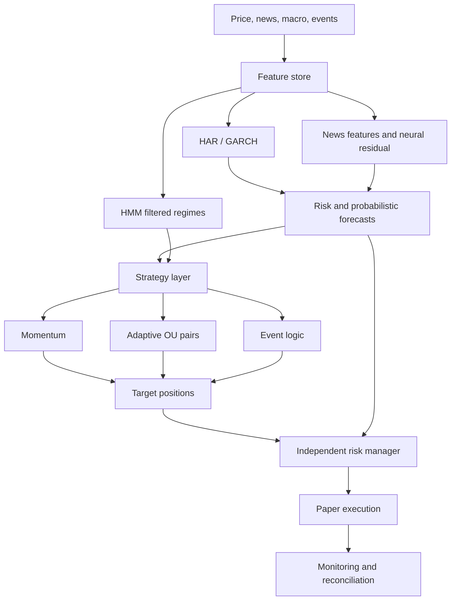

# Expanded project architecture

> **Status: proposed design.** This document records the supplied architecture for future
> development. It is separate from the implemented baseline described in
> [the current architecture](architecture.md) and [the roadmap](roadmap.md).
> All trading remains simulated. Numerical examples and historical date ranges below are
> illustrative; model effectiveness must be established through the proposed validation gates.

The upgraded system is basically taking your original **autonomous paper-trading agent** and adding a much stronger **forecasting, regime-awareness, and scientific-validation layer** around it. The goal is not to make the agent more complicated for its own sake; every new component needs to answer a specific question and prove that it improves out-of-sample performance.

| New idea                                      | What it does                                                                | Why we’re adding it                                                | How it affects trades                                               |
| --------------------------------------------- | --------------------------------------------------------------------------- | ------------------------------------------------------------------ | ------------------------------------------------------------------- |
| **1. HAR/GARCH volatility baseline**          | Predicts future volatility from past volatility/returns                     | Gives us a strong, interpretable baseline before using ML          | Determines risk, position size, stop widths                         |
| **2. News surprise + novelty features**       | Measures how unexpected and unusual a news event is                         | Research supports news more for **volatility/risk** than direction | Can reduce/increase exposure around important events                |
| **3. Neural residual model**                  | ML learns what the basic volatility model consistently misses               | Lets ML add value without replacing a reliable statistical model   | Improves the final risk/volatility forecast                         |
| **4. HMM regime detection**                   | Estimates whether the market is quiet, trending, volatile, stressed, etc.   | Different strategies work differently in different environments    | Changes which strategies are active and how much risk they can take |
| **5. Adaptive OU / pairs trading**            | Trades temporary deviations between historically related assets             | Gives us a mathematically clear mean-reversion strategy            | Generates long/short pair trades when spreads deviate enough        |
| **6. Volatility targeting**                   | Adjusts position size based on predicted risk                               | Keeps risk more consistent instead of using fixed position sizes   | Higher vol → smaller positions; lower vol → potentially larger      |
| **7. Event-risk layer**                       | Recognizes CPI, Fed, earnings, etc. separately from ordinary news           | Scheduled events behave differently from normal market periods     | Can tighten risk or temporarily avoid strategies around events      |
| **8. Probabilistic forecasting**              | Predicts a distribution rather than just “up/down”                          | Markets are uncertain; risk decisions need probabilities           | Agent gets expected return, volatility, tail risk, quantiles        |
| **9. Better validation / leakage protection** | Prevents future information from contaminating training                     | Financial ML is extremely prone to fake backtest performance       | Stops us from promoting strategies that only look good historically |
| **10. Multiple-testing controls**             | Accounts for the fact that we try many strategies/models                    | If we test 100 strategies, some will look good by chance           | Only statistically convincing strategies get promoted               |
| **11. Shadow-model system**                   | Experimental models run alongside the main system without controlling money | Lets us safely evaluate things like PPO                            | Challenger must beat production before getting authority            |
| **12. Stronger observability**                | Logs signals, forecasts, regimes, trades, errors, PnL and risk              | Makes every decision explainable and debuggable                    | We can identify exactly why a trade happened or failed              |

Here is what each one means in practical terms.

### 1. HAR/GARCH volatility forecasting

Instead of assuming tomorrow has the same risk as today, we estimate future volatility.

For example:

$$
\sigma_{t+1}=f(\sigma_t,\sigma_{\text{week}},\sigma_{\text{month}})
$$

A HAR-style model looks at volatility across multiple time horizons, while GARCH models how recent shocks affect current volatility.

This becomes one of the most important inputs to the agent.

Suppose SPY normally has predicted daily volatility of 1%, but our model suddenly predicts 2.2%.

The system does **not necessarily say “sell SPY.”**

Instead it says:

> The same trade is now more dangerous.

So a $20,000 position might become a $9,000 position.

This is a much more defensible use of quantitative forecasting than trying to perfectly predict tomorrow's direction.

---

### 2. News **surprise** instead of simple sentiment

We are upgrading the concept of news.

Simple sentiment asks:

> Is this headline positive or negative?

That is often weak.

Instead we care about:

$$
\text{Surprise}= \text{Actual}-\text{Expected}
$$

For CPI:

```
Expected CPI = 2.7%
Actual CPI   = 3.1%

Surprise = +0.4 percentage points
```

The market often reacts to the **difference from expectations**, not merely whether a number sounds good or bad.

We will also calculate **novelty**.

A headline saying something the market has seen 30 times this week is less informative than genuinely new information.

So news features become roughly:

```
event_type
sentiment
surprise
novelty
news_volume
timestamp
entity
source
```

Your PMDS plan specifically makes this distinction and treats surprise/novelty as more useful than vague “information entropy.”

---

### 3. Neural residual learning

This is one of the more interesting ML additions.

We do **not** ask a neural network to learn the entire market from scratch.

First:

$$
\text{HAR/GARCH} \rightarrow \hat\sigma
$$

Then calculate its historical errors:

$$
e_t = \sigma_t-\hat\sigma_t
$$

The neural network learns:

> Under what circumstances does the traditional model tend to be wrong?

For example, HAR might predict:

$$
\sigma=1.4\%
$$

but the neural model sees unusual news + options activity + macro conditions and predicts:

$$
\Delta \sigma = +0.3\%
$$

giving:

$$
\hat\sigma_{\text{final}}=1.7\%.
$$

This keeps the model anchored to something interpretable instead of letting the neural network invent the entire forecast.

Your PMDS design calls this **residual learning with shrinkage toward the econometric baseline**.

---

### 4. HMM market regimes

Markets do not behave like one single statistical environment.

An HMM—Hidden Markov Model—tries to infer an invisible market state.

For example:

```
Regime 0 — quiet / low volatility
Regime 1 — normal
Regime 2 — strong trend
Regime 3 — stressed / crisis
```

We don't directly observe the regime.

Instead the model sees things like:

```
returns
volatility
volume
correlations
momentum
```

and estimates:

$$
P(\text{stress regime})=72\%.
$$

The most important change is that the HMM **will not directly say buy or sell**.

Instead it changes the behavior of other strategies.

Example:

```
Normal regime

Momentum: 100%
Pairs:    100%
Risk:     normal

Stress regime

Momentum: 40%
Pairs:    0%
Risk:     35%
Cash:     increased
```

Think of HMM as the agent's **environment detector**.

---

### 5. Adaptive OU pairs trading

Suppose Coke and Pepsi historically move together.

Construct a spread:

$$
X_t=P_{\text{KO}}-\beta P_{\text{PEP}}
$$

If the relationship is mean reverting, we can model it approximately as:

$$
dX_t=\theta(\mu-X_t)dt+\sigma dW_t.
$$

If the spread becomes unusually high:

```
KO expensive relative to PEP
```

the strategy might:

```
SHORT KO
LONG PEP
```

expecting the spread to return toward normal.

But we are adding an important safeguard.

The system must continuously test whether the pair **still mean reverts**.

If the relationship breaks:

```
cointegration fails
half-life becomes too long
β becomes unstable
transaction costs exceed expected profit
```

the pair gets disabled.

So OU is not:

> these two stocks always come back together.

It is:

> these two currently appear to exhibit statistically defensible mean reversion.

---

### 6. Volatility targeting

Instead of:

```
Every trade = $10,000
```

we size trades according to risk.

Simplified:

$$
w_t = \frac{\sigma_{\text{target}}} {\hat\sigma_t}
$$

Suppose target volatility is 10%.

If predicted strategy volatility is 20%:

$$
w=10/20=0.5
$$

so the strategy runs at half size.

If predicted volatility increases sharply, exposure automatically decreases.

This prevents the same nominal position from becoming dramatically more dangerous during market stress.

---

### 7. Event-aware risk

The agent will know when a major scheduled event is coming.

For example:

```
8:30 AM CPI
2:00 PM Federal Reserve decision
4:00 PM AAPL earnings
```

These periods behave differently from ordinary markets.

So we can define things like:

```
FED_EVENT = true
minutes_to_event = 23
expected_event_volatility = high
```

Then risk rules can respond.

For example:

```
Normal leverage: 1.0x

30 minutes before FOMC:
0.4x

5 minutes before:
0.2x
```

This does not require predicting what Powell will say.

It simply recognizes:

> uncertainty is unusually high.

---

### 8. Predict distributions instead of just direction

Instead of asking:

> Will SPY go up tomorrow?

we want something closer to:

$$
r_{t+1}\sim P(r|X_t).
$$

The output might be:

```
Expected return:      +0.08%
Expected volatility:   1.4%

5% return quantile:    -2.1%
95% return quantile:   +2.3%

Probability loss >2%:  6.8%
```

That is much more useful to a trading system.

It lets the risk engine answer questions such as:

> How much could we reasonably lose?

> How large should the position be?

> Is the expected profit large enough relative to the risk?

---

### 9. Purged walk-forward testing

Normal machine-learning cross-validation is dangerous for finance.

Markets are chronological.

So instead of randomly mixing training/test observations:

```
random train/test split ❌
```

we use:

```
TRAIN            TEST
2018–2021 →      2022

TRAIN
2018–2022 →      2023

TRAIN
2019–2023 →      2024
```

Then repeat.

We also create a gap—an **embargo**—between training and testing when labels overlap.

This reduces information leakage.

Your PMDS plan explicitly includes purging, embargoes, nested hyperparameter selection and a sealed final holdout.

---

### 10. A sealed final test

This is particularly important.

Imagine we continuously check performance on 2025 data.

Eventually we start changing the model because we know how it performed in 2025.

At that point, **2025 isn't truly out-of-sample anymore**.

Instead we reserve a period:

```
TRAIN / DEVELOPMENT

2010–2023
      ↓
hundreds of experiments


VALIDATION

2024
      ↓
model selection


SEALED HOLDOUT

2025–2026
      ↓
RUN ONCE
```

We don't touch the holdout until the system is finalized.

That gives us a much more credible measure of whether the strategy genuinely generalizes.

---

### 11. Multiple-testing protection

Suppose we test:

```
200 moving averages
30 momentum windows
50 pair thresholds
20 neural networks
15 risk rules
```

Eventually something will look amazing **just by luck**.

So we track every experiment.

Then use statistical techniques such as:

```
Reality Check / SPA
Model Confidence Set
Deflated performance metrics
```

to ask:

> Is this strategy really good, or did it just win because we tested hundreds of strategies?

This is one of the most important scientific improvements.

---

### 12. Shadow models

Some interesting models are too risky or poorly validated to immediately control trades.

PPO is the biggest example.

Instead:

| Model | Authority |
| --- | --- |
| Validated champion | Generates approved paper orders through the risk manager |
| PPO challenger | Logs proposed decisions for comparison without order authority |

Both see identical market data.

We record:

```
Production decision
PPO decision
subsequent return
turnover
drawdown
risk
costs
```

Eventually we can determine whether PPO genuinely improves performance.

Only then would it earn more control.

This gives us a clean rule:

> **complex models must earn promotion.**

---

## The resulting intelligence stack

The final system becomes:



The fundamental philosophy is:

**simple quantitative models create the baseline; ML is allowed to improve them; regimes control when strategies are appropriate; risk models determine how aggressively they trade; and rigorous validation determines whether anything survives at all.**

That is a much stronger project than simply putting PPO on historical prices and calling the result an autonomous AI trader.
